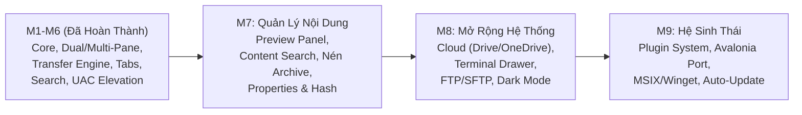

# MyFileManager

Trình quản lý tệp đa cửa sổ (multi-pane) hiệu năng cao cho Windows, được xây dựng bằng **.NET 10**, **WPF**, và kiến trúc **MVVM** hiện đại (`CommunityToolkit.Mvvm`).

> **Trạng thái hiện tại:** Đang phát triển tích cực · 109 commits · 170+ file mã nguồn · ~39.000 dòng code ứng dụng + ~11.000 dòng test · 532 bài kiểm thử tự động (100% PASS)

---

## Mục Lục

1. [Giới Thiệu](#1-giới-thiệu)
2. [Tính Năng Đã Hoàn Thành](#2-tính-năng-đã-hoàn-thành)
3. [Ảnh Chụp Màn Hình](#3-ảnh-chụp-màn-hình)
4. [Hướng Dẫn Cài Đặt & Chạy](#4-hướng-dẫn-cài-đặt--chạy)
5. [Cấu Trúc Dự Án](#5-cấu-trúc-dự-án)
6. [Kiến Trúc Hệ Thống](#6-kiến-trúc-hệ-thống)
7. [Phím Tắt & Thao Tác Chuột](#7-phím-tắt--thao-tác-chuột)
8. [Kiến Trúc Transfer Engine](#8-kiến-trúc-transfer-engine)
9. [Benchmark Hiệu Năng](#9-benchmark-hiệu-năng)
10. [Chính Sách Kiểm Thử](#10-chính-sách-kiểm-thử)
11. [Lịch Sử Phát Triển (Milestones)](#11-lịch-sử-phát-triển-milestones)
12. [Roadmap & Kế Hoạch Tương Lai](#12-roadmap--kế-hoạch-tương-lai)
13. [Hạn Chế Hiện Tại](#13-hạn-chế-hiện-tại)

---

## 1. Giới Thiệu

**MyFileManager** là trình quản lý tệp desktop đa cửa sổ, tập trung vào:

- **Năng suất bàn phím:** Điều hướng nhanh bằng phím tắt, Quick Open (`Ctrl+P`), Command Palette (`Ctrl+Shift+P`)
- **An toàn dữ liệu tuyệt đối:** Mọi thao tác (Copy, Move, Rename, Delete, Overwrite) đều có thể hoàn tác (Undo) với journal chống crash
- **Tích hợp Windows sâu:** Context menu gốc Windows (IContextMenu), SendTo, ShellNew, Recycle Bin, kéo-thả OLE với Explorer
- **Đa cửa sổ linh hoạt:** Hỗ trợ từ 1 đến 16 cửa sổ (pane), kéo-thả tab để chia/gộp/hoán đổi vị trí, lưu trữ phiên làm việc

---

## 2. Tính Năng Đã Hoàn Thành

### 🗂️ Quản Lý Tệp Cơ Bản
- Duyệt thư mục với danh sách ảo hóa (virtualized) — hiển thị 10.000+ mục mượt mà
- 3 chế độ hiển thị: **Details** (bảng chi tiết), **Icons** (biểu tượng), **Preview** (xem trước)
- Sắp xếp theo Tên / Ngày / Kích thước / Loại (tăng/giảm), thư mục luôn ở trên
- Lọc nhanh trong thư mục (`Ctrl+Shift+F`) với so khớp không phân biệt dấu tiếng Việt
- Gõ ký tự để nhảy đến mục khớp (type-to-select) với timeout 1 giây
- Hiện/ẩn tệp ẩn và tệp hệ thống (`Ctrl+H`)

### 📑 Hệ Thống Tab
- Mỗi cửa sổ (pane) có hệ thống tab độc lập — nhiều thư mục cùng mở song song
- Mỗi tab lưu riêng: lịch sử điều hướng, chế độ hiển thị, cách sắp xếp, bộ lọc, danh sách file đã cache
- Kéo-thả tab để sắp xếp lại thứ tự trong cùng pane
- Kéo tab giữa các pane để di chuyển tab
- Đóng tab bằng nút × hoặc click chuột giữa
- Phục hồi tab khi khởi động lại ứng dụng (session persistence)

### 🪟 Đa Cửa Sổ (Multi-Pane Workspace)
- 5 bố cục có sẵn: **Đơn**, **Đôi dọc**, **Đôi ngang**, **Ba cửa sổ (TripleLeft)**, **Lưới 4 ô (QuadGrid)**
- Kéo-thả tab vào thân pane để **hoán đổi vị trí** giữa các cửa sổ
- Kéo tab vào cạnh pane (trái/phải/trên/dưới) để **tách & dock** — mở rộng lên đến 16 pane
- Preview overlay màu hồng hiển thị vùng sẽ dock trước khi thả
- Thanh chia (splitter) có thể kéo để điều chỉnh kích thước giữa các pane

### 🧭 Điều Hướng
- Lịch sử Back/Forward hai pha (two-phase) — không bao giờ mất đồng bộ khi điều hướng thất bại
- **Breadcrumb bar** tương tác: click từng phân đoạn đường dẫn để nhảy, nhấn chevron `›` để mở dropdown danh sách thư mục con
- Thanh địa chỉ chỉnh sửa trực tiếp (`Ctrl+L`) — hỗ trợ `shell:`, `::{CLSID}`, biến môi trường (`%USERPROFILE%`), đường dẫn `~`
- Sidebar cố định: Desktop, Documents, Downloads, This PC, Recycle Bin + tất cả ổ đĩa

### 🔍 Tìm Kiếm & Quick Open
- **Tìm kiếm đệ quy** (`Ctrl+F`): Quét toàn bộ cây thư mục con với Channel batching, tránh vòng lặp (loop avoidance)
- **Quick Open** (`Ctrl+P`): Tìm kiếm fuzzy thư mục, tab đang mở, mục yêu thích, thư mục gần đây, ổ đĩa
  - Xếp hạng Frecency (tần suất + gần đây) dựa trên lịch sử truy cập
  - Chỉ mục 200.000+ thư mục với latency < 5ms mỗi phím
  - Bộ so khớp fuzzy với diacritic-insensitive cho tiếng Việt (ví dụ: gõ "tai lieu" tìm được "tài liệu")
- **Command Palette** (`Ctrl+Shift+P`): Truy cập nhanh mọi lệnh ứng dụng qua tên

### 📋 Thao Tác Tệp
- **Copy / Move** giữa các pane (`Ctrl+Shift+C` / `Ctrl+Shift+M`) với Transfer Engine cấp doanh nghiệp
- **Delete / Shift+Delete**: Xóa vào Thùng rác hoặc xóa vĩnh viễn, có hộp thoại xác nhận
- **Tạo mới** (New menu): Thư mục, tệp văn bản, và tất cả ShellNew template đã đăng ký trên Windows
- **Đổi tên** (`F2`): Inline rename trực tiếp trên danh sách
- **Đổi tên hàng loạt** (Multi-Rename): Pattern token `{name}`, `{ext}`, `{counter}`, `{date}`, tìm/thay thế regex, xem trước trực tiếp
- **Giải nén ZIP** tích hợp: Kiểm tra bảo mật (zip-slip, bomb detection, file count/size limit), tích hợp hàng đợi transfer
- **Nâng quyền UAC (M5d)**: Thử lại thao tác với quyền Quản trị viên (Administrator) an toàn khi gặp lỗi `UnauthorizedAccessException` thông qua worker độc lập `FM.Elevated.exe` với xác thực mã băm SHA-256 chống TOCTOU
- **Hoàn tác** (`Ctrl+Z`): Undo cho Create, Rename, Copy, Move, Overwrite, Delete (khôi phục từ Recycle Bin)
- **SendTo**: Menu "Send To" giống Windows Explorer (Desktop shortcut, Documents, ổ USB, nén ZIP)
- **Create Shortcut**: Tạo shortcut `.lnk` cho tệp/thư mục đã chọn

### 🖱️ Kéo & Thả (Drag and Drop)
- Kéo-thả giữa các pane: Move cùng ổ, Copy khác ổ (mặc định theo quy tắc Windows)
- Kéo-thả với Windows Explorer và Desktop — hai chiều
- Giữ `Ctrl` = Copy, giữ `Shift` = Move (ghi đè hành vi mặc định)
- Kéo vào thư mục con: highlight thư mục đích với viền xanh
- Bảo vệ kéo vào chính mình hoặc thư mục cha: hiển thị con trỏ ⊘ No-Drop
- Ghost adorner (bóng tab/file) theo chuột trong khi kéo

### 📦 Transfer Engine & Hệ Thống An Toàn
- **Transfer Drawer**: Panel tiến trình ở dưới cùng — tốc độ, ETA, thanh tiến trình, Pause/Resume/Cancel
- **Hàng đợi thông minh**: Nối tiếp trên cùng ổ đĩa (tránh thrashing), song song giữa các ổ khác nhau
- **Xung đột tệp**: Hộp thoại so sánh side-by-side với thumbnail, nhãn Newer/Larger, Apply to All
- **Staging Backup**: Sao lưu tệp trước khi ghi đè → Undo overwrite 100% an toàn
- **Write-Ahead Journal**: Nhật ký JSONL chống crash — khôi phục hoàn toàn sau khi ứng dụng bị kill
- **Crash Recovery**: Tự động phát hiện transfer dở dang khi khởi động lại, dọn dẹp `.fmpart`, rollback

### 🖥️ Tích Hợp Windows
- **Context menu gốc** (IContextMenu): Hiển thị menu chuột phải giống hệt Windows Explorer — bao gồm WinRAR, Open With, Pin to Start, và mọi shell extension đã cài
- **Recycle Bin**: Duyệt, khôi phục, làm trống Thùng rác trực tiếp trong ứng dụng
- **This PC**: Hiển thị tất cả ổ đĩa dạng card với dung lượng trống/đã dùng
- **Shell icon & thumbnail**: Trích xuất biểu tượng và ảnh thu nhỏ trên luồng STA riêng biệt, cache LRU 64 mục
- **Single Instance**: Chỉ cho phép 1 bản ứng dụng chạy — bản thứ 2 gửi đường dẫn qua named pipe
- **Crash Report**: Dialog thông báo lỗi chi tiết khi ứng dụng crash bất ngờ

### ⚙️ Cài Đặt & Lưu Trữ
- Lưu cài đặt người dùng vào `%LOCALAPPDATA%\MyFileManager\settings.json`
- Phục hồi phiên làm việc: kích thước cửa sổ, bố cục pane, đường dẫn đang mở, tab, lịch sử điều hướng
- Tùy chỉnh: hiện/ẩn tệp ẩn, xác nhận trước khi xóa, bố cục workspace

### 📊 Theo Dõi Thay Đổi (File Watching)
- `FileSystemWatcher` theo dõi thay đổi real-time trong thư mục đang mở
- `PollingFolderWatcher` dự phòng cho ổ mạng không hỗ trợ FSW
- Coalescer gộp nhiều sự kiện liên tiếp (create → rename, delete → create) thành 1 cập nhật
- Bảo vệ inline rename: không làm gián đoạn khi đang đổi tên
- Tự động chuyển hướng khi thư mục đang xem bị xóa

---

## 3. Ảnh Chụp Màn Hình

> *Ảnh chụp UI thực tế sẽ được bổ sung tại đây.*

---

## 4. Hướng Dẫn Cài Đặt & Chạy

### Yêu Cầu
- **Hệ điều hành:** Windows 10/11
- **IDE:** Visual Studio 2022 (v17.12+) với workload **.NET desktop development**
- **SDK:** .NET 10.0 SDK

### Cách A: Chạy trong Visual Studio (Khuyến nghị)
1. Mở `MyFileManager.sln` bằng Visual Studio.
2. Đặt **`FM.App`** làm Startup Project.
3. Nhấn **F5** để biên dịch và chạy.

### Cách B: Chạy bằng .NET CLI
```bash
cd MyFileManager

# Biên dịch toàn bộ solution (0 warning, 0 error)
dotnet build MyFileManager.sln

# Chạy toàn bộ bài kiểm thử (532 tests)
dotnet test MyFileManager.sln

# Chạy benchmark streaming thư mục
dotnet run --project tests/FM.Benchmarks/FM.Benchmarks.csproj

# Chạy benchmark transfer engine 2GB trong bộ nhớ (0 ghi đĩa)
dotnet run --project tests/FM.Benchmarks/FM.Benchmarks.csproj -c Release -- --transfer

# Chạy benchmark Quick Open fuzzy ranking
dotnet run --project tests/FM.Benchmarks/FM.Benchmarks.csproj -c Release -- --quickopen

# Khởi chạy ứng dụng
dotnet run --project src/FM.App/FM.App.csproj
```

---

## 5. Cấu Trúc Dự Án

```
MyFileManager/
├── src/
│   ├── FM.Core/                      # Thư viện logic nghiệp vụ thuần (KHÔNG phụ thuộc WPF)
│   │   ├── CommandLine/              # Phân tích dòng lệnh khởi động
│   │   ├── Drives/                   # Dịch vụ liệt kê ổ đĩa
│   │   ├── Elevation/                # Hợp đồng & quy tắc kiểm tra an ninh nâng quyền
│   │   ├── FileSystem/               # IFileSystem trừu tượng + InMemory + Physical
│   │   ├── Helpers/                  # Sắp xếp, validate tên tệp, tiện ích đường dẫn
│   │   ├── Logging/                  # Crash logger
│   │   ├── Models/                   # FileEntry, FileSortColumn
│   │   ├── Navigation/               # NavigationHistory hai pha
│   │   ├── Operations/               # Thao tác hoàn tác được
│   │   │   ├── MultiRename/          # Đổi tên hàng loạt (token, regex, preview)
│   │   │   ├── Transfer/             # Transfer Engine đầy đủ
│   │   │   │   ├── TransferPlanner   # Quét cây, phát hiện vòng lặp, kiểm tra dung lượng
│   │   │   │   ├── TransferEngine    # Copy/Move chunk, .fmpart staging, SHA-256
│   │   │   │   ├── PauseGate         # Tạm dừng/tiếp tục hợp tác
│   │   │   │   ├── TransferQueue     # Hàng đợi đa ổ, nối tiếp trên cùng ổ
│   │   │   │   ├── StagingBackup     # Sao lưu trước ghi đè cho Undo
│   │   │   │   └── UndoJournal       # JSONL write-ahead log chống crash
│   │   │   └── Zip/                  # Giải nén ZIP với bảo mật
│   │   ├── PathResolution/           # Phân giải shell:, ::{CLSID}, biến môi trường
│   │   ├── RecycleBin/               # Thùng rác Windows (SHFileOperation)
│   │   ├── Search/                   # Tìm kiếm fuzzy, indexer, crawler
│   │   ├── Services/                 # DirectoryService (Channel-based)
│   │   ├── ShellIntegration/         # SendTo, ShellNew, đăng ký shell
│   │   └── Watching/                 # FileSystemWatcher + Polling + Coalescer
│   │
│   ├── FM.Elevated/                  # Worker tiến trình đặc quyền (Console, net10.0, zero WPF)
│   │   ├── Program.cs                # Entry point: hash verify, path security, batch executor
│   │   └── FM.Elevated.csproj        # Console executable
│   │
│   └── FM.App/                       # Ứng dụng WPF (Views & ViewModels)
│       ├── Collections/              # BulkObservableCollection hiệu năng cao
│       ├── Converters/               # Value converters cho XAML binding
│       ├── Helpers/                  # Visual tree, drop effect resolver, format
│       ├── Models/                   # Tab, Breadcrumb, DockEdge, ViewMode, Layout
│       ├── Services/
│       │   ├── Elevation/            # Windows & Fake elevation services
│       │   ├── QuickOpen/            # Nguồn dữ liệu & catalog cho Quick Open
│       │   ├── SingleInstance/       # Named pipe single-instance enforcement
│       │   ├── Icon/Thumbnail        # STA thread worker + cache
│       │   ├── Settings              # AppData JSON persistence
│       │   ├── Shell                 # ShellNew, SendTo, context menu
│       │   └── Transfer Dialog       # Conflict/failure dialog WPF
│       ├── ViewModels/               # 11 ViewModels
│       │   ├── MainViewModel         # Điều phối workspace, sidebar, transfer queue
│       │   ├── FilePaneViewModel     # Logic pane: tab, navigation, sort, search
│       │   ├── QuickOpenViewModel    # Quick Open & Command Palette
│       │   ├── MultiRenameViewModel  # Đổi tên hàng loạt
│       │   ├── TransferDrawer/Job    # Panel tiến trình transfer
│       │   └── ...                   # Conflict, DriveCard, RecycleBin, Sidebar
│       └── Views/                    # 9 UserControl + MainWindow + App
│           ├── FilePaneView          # Pane chính: listview, breadcrumb, drag-drop
│           ├── MultiPaneWorkspace    # Bố cục đa cửa sổ + splitter
│           ├── QuickOpenView         # Overlay Quick Open
│           ├── TransferDrawerView    # Panel tiến trình
│           ├── ConflictDialog        # Hộp thoại xung đột tệp
│           ├── MultiRenameDialog     # Hộp thoại đổi tên hàng loạt
│           └── ...                   # CrashReport, Failure, Input
│
├── tests/
│   ├── Common/TestWorkspace.cs       # Test workspace giới hạn (max 200 file / 1 MiB)
│   ├── FM.Core.Tests/                # 295 bài kiểm thử logic nghiệp vụ
│   ├── FM.App.Tests/                 # 237 bài kiểm thử ViewModel & tích hợp
│   └── FM.Benchmarks/               # Benchmark hiệu năng (0 ghi đĩa)
│
├── MyFileManager.sln
└── README.md
```

---

## 6. Kiến Trúc Hệ Thống

### Nguyên Tắc Thiết Kế
- **FM.Core 100% không phụ thuộc WPF** — toàn bộ logic nghiệp vụ có thể test với fake/mock, không cần UI
- **MVVM nghiêm ngặt** với `CommunityToolkit.Mvvm` source generators — View không chứa logic
- **Dependency Injection** qua `Microsoft.Extensions.DependencyInjection`
- **Mọi thao tác I/O chạy trên background thread** — UI thread không bao giờ bị block

### Sơ Đồ Kiến Trúc Tổng Quan

```
┌─────────────────────────────────────────────────────┐
│                    FM.App (WPF)                     │
│  ┌──────────┐  ┌──────────────┐  ┌───────────────┐ │
│  │  Views    │  │  ViewModels  │  │  Services     │ │
│  │  (XAML)   │──│  (MVVM)      │──│  (Icon, DI,   │ │
│  │          │  │              │  │   Settings)   │ │
│  └──────────┘  └──────┬───────┘  └───────────────┘ │
│                       │                             │
├───────────────────────┼─────────────────────────────┤
│                       │                             │
│                FM.Core (Pure .NET)                   │
│  ┌──────────┐  ┌──────┴───────┐  ┌───────────────┐ │
│  │FileSystem│  │  Operations  │  │   Search      │ │
│  │(Physical/│  │  (Transfer,  │  │   (Fuzzy,     │ │
│  │ InMemory)│  │   Rename,    │  │    Crawler,   │ │
│  │          │  │   Undo)      │  │    Index)     │ │
│  └──────────┘  └──────────────┘  └───────────────┘ │
│  ┌──────────┐  ┌──────────────┐  ┌───────────────┐ │
│  │Navigation│  │  RecycleBin  │  │   Watching    │ │
│  │(History) │  │  (Shell API) │  │   (FSW/Poll)  │ │
│  └──────────┘  └──────────────┘  └───────────────┘ │
└─────────────────────────────────────────────────────┘
```

### Các Thành Phần Chính

| Thành phần | Dòng code | Vai trò |
|:---|---:|:---|
| `FilePaneViewModel` | 3.361 | Logic pane: tabs, navigation, sort, search, file ops, drag-drop, watcher |
| `MainViewModel` | 2.593 | Điều phối workspace, sidebar, layout, transfer queue, session persist |
| `FilePaneView.xaml/.cs` | ~3.600 | UI pane: virtualized listview, breadcrumb, OLE drag-drop, dock preview |
| `MultiPaneWorkspace.xaml/.cs` | ~1.300 | Bố cục đa pane, splitter, dock preview, quản lý view instances |
| `TransferEngine` | ~600 | Copy/Move chunk, .fmpart staging, SHA-256 verification |
| `SearchService` | ~400 | Tìm kiếm đệ quy Channel-based, loop avoidance |
| `FuzzyMatcher` | ~300 | Fuzzy ranking diacritic-insensitive, gap-penalized scoring |

---

## 7. Phím Tắt & Thao Tác Chuột

### Điều Hướng

| Phím tắt | Chức năng |
|:---|:---|
| `Enter` | Mở thư mục / chạy file / xác nhận thanh địa chỉ |
| `Backspace` | Lên thư mục cha |
| `Alt + ←` | Quay lại (Back) |
| `Alt + →` | Đi tới (Forward) |
| `Ctrl + L` | Focus vào thanh địa chỉ |
| `F5` | Làm mới danh sách |
| `Tab` | Chuyển pane hoạt động (khi focus ở danh sách file) |

### Thao Tác Tệp

| Phím tắt | Chức năng |
|:---|:---|
| `Ctrl + Shift + N` | Tạo thư mục mới |
| `F2` | Đổi tên |
| `Delete` | Xóa vào Thùng rác |
| `Shift + Delete` | Xóa vĩnh viễn |
| `Ctrl + Shift + C` | Copy sang pane đối diện |
| `Ctrl + Shift + M` | Move sang pane đối diện |
| `Ctrl + Z` | Hoàn tác (Undo) |

### Tìm Kiếm & Quick Open

| Phím tắt | Chức năng |
|:---|:---|
| `Ctrl + P` | Quick Open (tìm thư mục, tab, favorites, recents, drives) |
| `Ctrl + Shift + P` | Command Palette (tìm & chạy lệnh ứng dụng) |
| `Ctrl + Shift + F` | Focus vào ô lọc thư mục |
| `Ctrl + F` | Tìm kiếm đệ quy |
| `Esc` | Xóa bộ lọc / đóng dialog / hủy chỉnh sửa |
| Gõ ký tự | Nhảy đến mục khớp (type-to-select, timeout 1s) |

### Kéo & Thả

| Thao tác | Chức năng |
|:---|:---|
| Kéo file giữa các pane | Move (cùng ổ) hoặc Copy (khác ổ) theo mặc định |
| `Ctrl` + Kéo | Luôn Copy |
| `Shift` + Kéo | Luôn Move |
| Kéo vào thư mục con | Thả trực tiếp vào thư mục con đó |
| Kéo tab trong pane | Sắp xếp lại thứ tự tab |
| Kéo tab sang pane khác | Di chuyển tab sang pane đó |
| Kéo tab vào thân pane | Hoán đổi vị trí 2 pane |

### Hiển Thị

| Phím tắt | Chức năng |
|:---|:---|
| `Ctrl + H` | Hiện/ẩn tệp ẩn & tệp hệ thống |

---

## 8. Kiến Trúc Transfer Engine

### Tổng Quan
Transfer Engine được thiết kế theo nguyên tắc **không bao giờ mất dữ liệu** qua nhiều lớp bảo vệ:

```
                    ┌──────────────┐
   User Request ──► │TransferPlanner│ Quét cây, phát hiện vòng lặp, kiểm tra dung lượng
                    └──────┬───────┘
                           │
                    ┌──────▼───────┐
                    │TransferQueue │ Nối tiếp cùng ổ, song song khác ổ (max 2 luồng)
                    └──────┬───────┘
                           │
                    ┌──────▼───────┐
                    │TransferEngine│ Copy chunk → .fmpart → SHA-256 → atomic rename
                    └──────┬───────┘
                           │
              ┌────────────┼────────────┐
              │            │            │
       ┌──────▼─────┐ ┌───▼────┐ ┌─────▼──────┐
       │StagingBackup│ │PauseGate│ │ UndoJournal│
       │(undo overw.)│ │(pause/ │ │(JSONL crash│
       │             │ │ resume)│ │ recovery)  │
       └─────────────┘ └────────┘ └────────────┘
```

### Chi Tiết Hoạt Động

| Thành phần | Chức năng |
|:---|:---|
| **TransferPlanner** | Mở rộng cây thư mục, bỏ qua reparse point/symlink, kiểm tra dung lượng trống, tạo tên KeepBoth |
| **TransferEngine** | Copy qua file tạm `.fmpart` (1-4 MiB chunk), hash SHA-256 song song, rename nguyên tử khi xong |
| **PauseGate** | Tạm dừng/tiếp tục hợp tác giữa các chunk — tiếp tục từ đúng byte offset, hủy tức thì khi đang pause |
| **TransferQueue** | Nối tiếp trên cùng ổ vật lý (tránh head thrashing), song song tối đa 2 lane khác ổ, progress throttle ≤ 10/giây |
| **StagingBackupStore** | Sao lưu file gốc trước khi ghi đè vào `%LOCALAPPDATA%\MyFileManager\staging\` — quota 5GB, tự dọn sau 7 ngày |
| **FileUndoJournalStore** | JSONL append-only log — phát hiện transfer dở khi khởi động → tự rollback, compaction khi khởi động |
| **TransferUndoOperation** | Undo Copy (xóa nếu chưa bị sửa), Undo Move (khôi phục vị trí gốc), Undo Overwrite (khôi phục từ staging) |

### Đảm Bảo An Toàn
- **Move cross-volume**: Copy trước → xác minh SHA-256 → **chỉ xóa nguồn sau khi đã verify đích**
- **Crash giữa chừng**: Journal ghi intent trước khi bắt đầu → khi khởi động lại, tự động dọn `.fmpart` và rollback
- **Overwrite có thể hoàn tác**: File gốc được backup → hiển thị banner xanh "Overwrite is undoable"

---

## 9. Benchmark Hiệu Năng

### Môi Trường Đo
- **CPU:** 12th Gen Intel Core i5-12450HX (12 logical processors)
- **RAM:** 16 GB DDR5
- **OS:** Windows 11 (NT 10.0.26300.0)
- **Runtime:** .NET 10.0

### A. Streaming Thư Mục (10.000 mục, in-memory)

| Chỉ số | Warm-up | Đo thực (Median/5 lần) |
|:---|:---:|:---:|
| Thời gian hiển thị batch đầu | 65 ms | **3 ms** |
| Thời gian load toàn bộ 10.000 mục | 778 ms | **293 ms** |
| Stall tối đa UI thread | 191 ms | **65 ms** |
| Working Set ban đầu | 28 MiB | 28 MiB |
| Working Set sau load | 136 MiB | 136 MiB |

### B. Transfer Engine (2 GB file ảo, 0 ghi đĩa)

| Chỉ số | Kết quả |
|:---|:---|
| Tổng bytes copy | **2.147.483.648 bytes (2,00 GiB)** |
| Thời gian thực thi | **217 ms** |
| Throughput | **9.421 MB/s** |
| Bộ nhớ cấp phát | **4,49 MiB** |
| Ghi đĩa vật lý | **0 bytes** |

### C. Quick Open Fuzzy Ranking (500 places + 80 commands)

| Chỉ số | Kết quả | Mục tiêu |
|:---|:---|:---|
| Số query | 1.300 | |
| Latency trung bình | **0,009 ms** | < 5 ms |
| Latency tối đa | **2,166 ms** | < 5 ms |

### D. Folder Index 200.000 Thư Mục

| Chỉ số | Kết quả | Mục tiêu |
|:---|:---|:---|
| Kích thước index | 200.000 thư mục | |
| Thời gian build index | 382 ms | |
| Latency trung bình | **2,358 ms** | < 30 ms |
| P95 Latency | **20,832 ms** | < 100 ms |

---

## 10. Chính Sách Kiểm Thử

### Tổng Quan Test Suite
- **FM.Core.Tests:** 295 bài kiểm thử — logic nghiệp vụ thuần, không WPF
- **FM.App.Tests:** 237 bài kiểm thử — ViewModel, tích hợp, plumbing
- **Tổng cộng: 532 bài kiểm thử**, 0 warning, 0 error

### Nguyên Tắc Zero-Disk
1. **Ngân sách cứng:** Không test nào tạo quá 200 file hoặc 5 MB trên đĩa
2. **InMemoryFileSystem:** Test engine chạy trên virtual file system — file 5 GB tốn 0 byte RAM, 0 byte disk
3. **TestWorkspace:** Workspace tạm trong `%TEMP%\FM_{purpose}_{guid}`, tự xóa khi Dispose(), quét stale directory > 1 giờ

---

## 11. Lịch Sử Phát Triển (Milestones)

| Milestone | Nội dung chính | Trạng thái |
|:---|:---|:---:|
| **M1** | Khởi tạo solution, DirectoryService, NavigationHistory, FileEntry | ✅ Hoàn thành |
| **M2** | Dual-pane layout, sidebar (Favorites + Drives), icon caching, keyboard shortcuts, settings persistence | ✅ Hoàn thành |
| **M3** | Single-instance (named pipe), startup settings, window bounds clamping | ✅ Hoàn thành |
| **v0.3** | TransferEngine (Copy/Move), conflict/failure dialog, UndoStack, file operations (Create, Rename) | ✅ Hoàn thành |
| **v0.4** | Drag-and-drop OLE, Transfer Drawer UI, Write-Ahead Journal, Staging Backup, Crash Recovery | ✅ Hoàn thành |
| **M4** | Tìm kiếm đệ quy, fuzzy matching, folder filter, type-to-select, Quick Open, Command Palette, FolderIndex + Crawler | ✅ Hoàn thành |
| **M5a** | Delete / Shift+Delete, Recycle Bin undo, New menu (ShellNew templates) | ✅ Hoàn thành |
| **M5b** | Multi-Rename / Bulk Rename (token, regex, live preview) | ✅ Hoàn thành |
| **M5c** | Giải nén ZIP tích hợp (bảo mật zip-slip/bomb, giới hạn, tích hợp queue) | ✅ Hoàn thành |
| **M5d** | Nâng quyền UAC (UAC Elevation Worker độc lập `FM.Elevated`, xác thực SHA-256 chống TOCTOU, path denylist, retry khi bị từ chối) | ✅ Hoàn thành |
| **M6** | Real tabs per pane, independent history/view mode/sort, watcher optimization, session persistence | ✅ Hoàn thành |
| **Workspace** | Multi-pane grid (lên đến 16 pane), tab drag-to-dock, splitter, DockEdge preview | ✅ Hoàn thành |
| **UI/UX** | Context menu gốc Windows, breadcrumb bar, view modes, SendTo, ghost drag adorner | ✅ Hoàn thành |

**Thời gian phát triển:** 30/10/2026 → 04/11/2026 (6 ngày) · 109 commits

---

## 12. Roadmap & Kế Hoạch Tương Lai

### 12.1. Chiến Lược Phát Triển Tổng Thể
Dự án **MyFileManager** được định hướng phát triển từ một trình duyệt file 2 cửa sổ cơ bản thành một **nền tảng quản lý tệp thông minh, toàn diện, bảo mật cao và hiệu năng vượt trội trên Windows**, từng bước mở rộng sang hệ sinh thái đa nền tảng và hỗ trợ cộng đồng mở rộng.



---

### 12.2. Giai Đoạn M7: Nâng Tầm Trải Nghiệm & Quản Lý Nội Dung (Q4/2026)

#### 🎯 Sub-milestone M7a: Preview Panel Đa Năng (File Content Preview)
* **Mục tiêu:** Bổ sung panel xem trước nội dung tệp ở cạnh phải màn hình hoặc overlay xem nhanh kiểu macOS Quick Look (phím tắt `Space` hoặc `Ctrl+Q`).
* **Định dạng hỗ trợ:**
  * **Hình ảnh:** JPG, JPEG, PNG, GIF (animated playback), BMP, WEBP, ICO, SVG, TIFF (kèm thông số Exif: camera, ISO, khẩu độ, ngày chụp; hỗ trợ phóng to/thu nhỏ, xoay ảnh).
  * **Video & Âm thanh:** MP4, MKV, AVI, MOV, MP3, WAV, FLAC, M4A với bộ điều khiển phát cơ bản (play/pause, thanh tua, âm lượng).
  * **Văn bản & Mã nguồn:** TXT, LOG, JSON, XML, YAML, C#, C++, Python, JavaScript, TypeScript, HTML, CSS (tự động nhận diện encoding, syntax highlighting, đánh số dòng, wrap text).
  * **Tài liệu & Đánh dấu:** Markdown (render HTML xem trước hoàn chỉnh kèm code block và bảng), PDF (render trang xem trước mượt mà không phụ thuộc Adobe Acrobat).
* **Kiến trúc & Giới hạn an toàn:**
  * Toàn bộ việc đọc tệp chạy trên background thread, nạp tối đa 20 MB đầu của file text để tránh tràn RAM.
  * Hủy tác vụ nạp (cancellation token) tức thì khi người dùng di chuyển sang chọn file khác trong danh sách.

#### 🎯 Sub-milestone M7b: Tìm Kiếm Nội Dung Tệp (File Content Search & Grep)
* **Mục tiêu:** Cho phép người dùng tìm kiếm chuỗi văn bản hoặc biểu thức chính quy (Regex) bên trong nội dung các tệp tin trong cây thư mục.
* **Chi tiết kỹ thuật:**
  * Cú pháp tìm kiếm linh hoạt: `content:"chuỗi cần tìm"` hoặc bật checkbox *"Tìm trong nội dung"*.
  * Tự động phát hiện encoding tệp (BOM detection, UTF-8 validator, Windows-1258 tiếng Việt, UTF-16 LE/BE).
  * Heuristic phát hiện tệp nhị phân (null-byte inspection trong 1.024 byte đầu) để bỏ qua các tệp thực thi / media, tránh lãng phí CPU.
  * Hiển thị danh sách kết quả kèm số dòng và đoạn trích (snippet) tô sáng từ khóa khớp.

#### 🎯 Sub-milestone M7c: Nén Tệp & Quản Lý Archive Toàn Diện (Compression & Virtual Archive)
* **Mục tiêu:** Nâng cấp từ giải nén ZIP hiện tại thành hệ thống quản lý nén/giải nén hoàn chỉnh.
* **Chi tiết kỹ thuật:**
  * Tạo file nén mới từ danh sách tệp/thư mục đã chọn (`Ctrl+Shift+Z` hoặc context menu).
  * Định dạng hỗ trợ tạo: `.zip`, `.tar.gz`. Định dạng hỗ trợ giải nén: `.zip`, `.7z`, `.rar`, `.tar`, `.gz`.
  * Hỗ trợ đặt mật khẩu mã hóa chuẩn AES-256 cho file nén.
  * Tùy chọn cấp độ nén: *Store (0), Fastest (1), Fast (3), Normal (5), Maximum (7), Ultra (9)*.
  * **Virtual Archive Navigation:** Cho phép nhấn Enter để đi vào trong file ZIP duyệt như một thư mục thông thường mà không cần giải nén ra đĩa.

#### 🎯 Sub-milestone M7d: Properties Dialog & Tính Toán Mã Băm (Properties & Checksum)
* **Mục tiêu:** Hộp thoại thuộc tính chuyên sâu phong cách Windows 11 Fluent (`Alt+Enter`).
* **Chi tiết kỹ thuật:**
  * Quét và đếm chính xác tổng dung lượng, số tệp con, số thư mục con theo thời gian thực mà không khóa UI.
  * Tính toán song song các mã băm: **SHA-256, SHA-1, MD5, CRC32**.
  * Hỗ trợ nút *"So sánh với Clipboard"* để người dùng kiểm tra ngay tính toàn vẹn của tệp tải về từ Internet.
  * Cho phép xem và thay đổi nhanh các thuộc tính hệ thống: `ReadOnly`, `Hidden`, `Archive`, `System`.

---

### 12.3. Giai Đoạn M8: Mở Rộng Hệ Thống & Tích Hợp Đám Mây (Q1/2027)

| Tính năng | Chi tiết kỹ thuật |
|:---|:---|
| **Lưu trữ đám mây (Cloud Storage)** | Tích hợp Google Drive, Microsoft OneDrive, Dropbox thông qua REST API ảo hóa dưới dạng Virtual Filesystem, cho phép duyệt, kéo-thả tải lên/xuống trực tiếp. |
| **Giao thức mạng từ xa (FTP/SFTP/WebDAV/SMB)** | Kết nối đến máy chủ Linux hoặc NAS từ xa qua giao thức SFTP (SSH), FTP, WebDAV, SMB; lưu trữ thông tin đăng nhập an toàn bằng Windows Credential Manager. |
| **Terminal Drawer tích hợp** | Panel dòng lệnh ở cạnh đáy (`Ctrl+\``) tích hợp sẵn PowerShell, CMD và WSL; tự động chuyển thư mục làm việc (`cd`) theo pane hiện hành. |
| **Giao diện Dark Mode & Fluent Design** | Hỗ trợ chuyển đổi mượt mà giữa Dark Mode và Light Mode (tự động theo Windows hoặc tùy chọn); hiệu ứng kính mờ Windows 11 Mica / Acrylic; cho phép tùy biến màu chủ đạo (Accent Color). |
| **So sánh tệp đôi (Dual-File Compare & Diff)** | Chọn 2 tệp văn bản ở 2 pane và kích hoạt cửa sổ so sánh song song (`Ctrl+Alt+D`); highlight trực quan các dòng được thêm, xóa hoặc sửa đổi. |
| **Bookmarks & Tag màu (Color Labels)** | Ghim thư mục thường dùng vào sidebar phân nhóm; gắn nhãn màu (Đỏ, Xanh, Vàng, Cam) cho tệp/thư mục để phân loại dự án trực quan. |

---

### 12.4. Giai Đoạn M9: Hệ Sinh Thái & Đa Nền Tảng (Q2/2027)

| Hạng mục | Định hướng triển khai |
|:---|:---|
| **Hệ thống Plugin mở rộng** | Xây dựng kiến trúc Plugin Engine dựa trên .NET Assembly Isolation (`AssemblyLoadContext`); cung cấp API công khai cho cộng đồng viết thêm: Previewer mới, Lưu trữ đám mây mới, Công cụ xử lý file tự động. |
| **Đa nền tảng (macOS / Linux)** | Tách hoàn toàn tầng giao diện WPF thành giao diện trừu tượng, triển khai phiên bản đa nền tảng bằng **Avalonia UI**, giữ nguyên 100% logic nghiệp vụ `FM.Core`. |
| **Đóng gói & Phân phối chuẩn** | Đóng gói cài đặt Windows bằng MSIX và WiX Toolset (MSI); đưa ứng dụng lên **Microsoft Store** và kho phần mềm **Windows Package Manager** (`winget install MyFileManager`). |
| **Tự động cập nhật (Auto-Updater)** | Tích hợp cơ chế tự động kiểm tra bản cập nhật và tải bản vá delta gọn nhẹ thông qua Velopack / Squirrel, cài đặt ngầm không làm gián đoạn người dùng. |

---

### 12.5. Kế Hoạch Cải Thiện Kỹ Thuật & Tối Ưu Hóa (Quality & Engineering Plan)

| Trọng tâm | Kế hoạch thực hiện & Tiêu chí nghiệm thu |
|:---|:---|
| **Khởi động lạnh (Cold-Start)** | Tối ưu thời gian khởi động từ đĩa xuống **< 250 ms** thông qua công nghệ biên dịch ReadyToRun (R2R) / Native AOT, trì hoãn nạp danh sách ổ đĩa ngoại vi (deferred lazy-init). |
| **Tối ưu hóa bộ nhớ (RAM Profiling)** | Tiến hành profiling bộ nhớ bằng JetBrains dotMemory; đảm bảo khi mở và đóng liên tục 100 tab hoặc duyệt qua 50.000 tệp, bộ nhớ Working Set không bị rò rỉ (no leak) và giải phóng sạch sau `GC.Collect()`. |
| **Xử lý Virtual OLE Payload** | Nâng cấp tầng OLE Drag-and-Drop hỗ trợ định dạng `FileGroupDescriptor` và `FileContents`, cho phép người dùng kéo trực tiếp tệp đính kèm từ Microsoft Outlook hoặc từ phần mềm nén (WinRAR/7-Zip) thả thẳng vào pane. |
| **Quốc tế hóa hoàn chỉnh (i18n)** | Xây dựng hệ thống tài nguyên chuỗi đa ngôn ngữ (Localization), hỗ trợ đầy đủ 3 ngôn ngữ: **Tiếng Việt, Tiếng Anh, Tiếng Nhật**; người dùng có thể đổi ngôn ngữ tức thì trong Settings mà không cần khởi động lại app. |
| **CI/CD Pipeline tự động** | Thiết lập quy trình GitHub Actions tự động: kích hoạt build, chạy 532+ unit tests, quét mã tĩnh (SonarQube / CodeQL) và tự tạo bản Release draft mỗi khi tạo Git Tag. |
| **Code Coverage Gate** | Nâng độ phủ kiểm thử tự động đạt tối thiểu **> 92%** cho `FM.Core` và **> 88%** cho `FM.App`. |

---

## 13. Hạn Chế Hiện Tại

| Hạn chế | Chi tiết |
|:---|:---|
| **Virtual OLE Payloads** | Chưa hỗ trợ kéo-thả file ảo (ví dụ: attachment từ Outlook, file trong archive) — chỉ xử lý `FileDrop` chuẩn |
| **External Explorer Move** | Khi kéo file từ MyFileManager sang Explorer, Explorer tự xử lý move — không thể ghi vào Undo stack nội bộ |
| **Giao diện chỉ tiếng Anh** | Hầu hết UI label bằng tiếng Anh, một số tooltip/badge bằng tiếng Việt — chưa có hệ thống i18n hoàn chỉnh |
| **Chỉ chạy trên Windows** | Phụ thuộc WPF và Win32 API — không khả dụng trên macOS/Linux |
| **Chưa có gói cài đặt MSIX/MSI** | Hiện chạy trực tiếp từ mã nguồn hoặc thư mục Release build — chưa có installer tự động |
| **Panel xem trước** | Chưa có panel xem trước nội dung file (dự kiến hoàn thành trong Milestone M7a) |
| **Nén file** | Chỉ hỗ trợ giải nén ZIP — tính năng tạo file nén dự kiến hoàn thành trong Milestone M7c |

---

## Giấy Phép

Dự án cá nhân — Vương Huỳnh © 2026.
